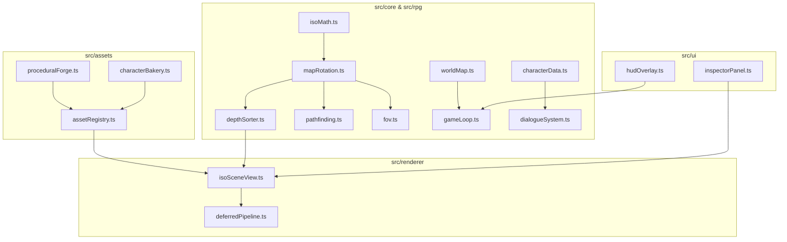

# Isometric 2.5D Browser cRPG Engine Implementation Plan

> **For agentic workers:** REQUIRED SUB-SKILL: Use superpowers:subagent-driven-development or TDD execution to implement this plan task-by-task. Steps use checkbox (`- [ ]`) syntax for tracking.

**Goal:** Build a complete, playable 2.5D Isometric cRPG Engine in the browser (`PixiJS v8` + custom WebGL2/Canvas2D Multi-Pass Deferred PBR Lighting + 4-way rotation + Topological Painter's DAG Depth Sorter + Modular Character Bakery + Dark Fantasy Vertical Slice & Live Engine Inspector).

**Architecture:** Deterministic mathematical & RPG simulation core (`src/core/`, `src/rpg/`) decoupled from procedural PBR asset/character baking (`src/assets/`) and GPU multi-pass rendering (`src/renderer/`) with an interactive Dark Fantasy HUD and Live Inspector (`src/ui/`).

**Architecture Diagram:**

**Tech Stack:** TypeScript 5, Vite, PixiJS v8, Vitest

**Spec:** [2026-11-06-isometric-crpg-engine-design.md](file:///C:/Users/jgorski/Projekty/RPG2/docs/superpowers/specs/2026-11-06-isometric-crpg-engine-design.md)

## Global Constraints

- Node.js + Vite + TypeScript strict mode (`noImplicitAny: true`)
- True 2:1 isometric projection (`TILE_WIDTH = 128`, `TILE_HEIGHT = 64`, `ELEVATION_STEP_PX = 24`)
- 100% deterministic unit tests via `vitest run` for all core mathematical, rotation, depth-sorting, pathfinding, FOV, and character-baking subsystems

---

### Task 1: Project Scaffolding & Isometric Math + 4-Way Rotation (`isoMath.ts`, `mapRotation.ts`)

**Files:**
- Create: `package.json`, `tsconfig.json`, `vite.config.ts`, `index.html`
- Create: `src/core/isoMath.ts`
- Create: `src/core/mapRotation.ts`
- Test: `tests/core/isoMath.test.ts`, `tests/core/mapRotation.test.ts`

- [ ] **Step 1: Write failing tests for `isoMath` and `mapRotation`**
- [ ] **Step 2: Run Vitest to confirm RED**
- [ ] **Step 3: Implement `src/core/isoMath.ts` and `src/core/mapRotation.ts`**
- [ ] **Step 4: Run Vitest to confirm GREEN and commit**

### Task 2: Topological DAG Depth Sorter (`depthSorter.ts`)

**Files:**
- Create: `src/core/depthSorter.ts`
- Test: `tests/core/depthSorter.test.ts`

- [ ] **Step 1: Write failing tests for single-tile, multi-tile ($2 \times 1$, $1 \times 2$), elevated entities, and cycle resolution**
- [ ] **Step 2: Run Vitest to confirm RED**
- [ ] **Step 3: Implement `src/core/depthSorter.ts`**
- [ ] **Step 4: Run Vitest to confirm GREEN and commit**

### Task 3: 3D A* Pathfinding & Recursive Shadowcasting FOV (`pathfinding.ts`, `fov.ts`)

**Files:**
- Create: `src/core/pathfinding.ts`
- Create: `src/core/fov.ts`
- Test: `tests/core/pathfinding.test.ts`, `tests/core/fov.test.ts`

- [ ] **Step 1: Write failing tests for 8-directional 3D A* with elevation steps and FOV shadowcasting with doors/walls**
- [ ] **Step 2: Run Vitest to confirm RED**
- [ ] **Step 3: Implement `src/core/pathfinding.ts` and `src/core/fov.ts`**
- [ ] **Step 4: Run Vitest to confirm GREEN and commit**

### Task 4: Modular Isometric Character Generator & Texture Bakery (`characterData.ts`, `characterBakery.ts`)

**Files:**
- Create: `src/rpg/characterData.ts`
- Create: `src/assets/characterBakery.ts`
- Test: `tests/assets/characterBakery.test.ts`

- [ ] **Step 1: Write failing tests for seed-deterministic random character generation, helmet-hair occlusion rules, recipe hashing, and 8-directional Albedo+Normal buffer baking**
- [ ] **Step 2: Run Vitest to confirm RED**
- [ ] **Step 3: Implement `src/rpg/characterData.ts` and `src/assets/characterBakery.ts`**
- [ ] **Step 4: Run Vitest to confirm GREEN and commit**

### Task 5: World Map, cRPG Dialogue & Game Loop (`worldMap.ts`, `dialogueSystem.ts`, `gameLoop.ts`)

**Files:**
- Create: `src/core/worldMap.ts`
- Create: `src/rpg/dialogueSystem.ts`
- Create: `src/rpg/gameLoop.ts`
- Test: `tests/rpg/gameLoop.test.ts`

- [ ] **Step 1: Write failing tests for Sanctum map construction, door toggle updating FOV/walkability, chest looting, equip updates, and NPC dialogue checks**
- [ ] **Step 2: Run Vitest to confirm RED**
- [ ] **Step 3: Implement `src/core/worldMap.ts`, `src/rpg/dialogueSystem.ts`, and `src/rpg/gameLoop.ts`**
- [ ] **Step 4: Run Vitest to confirm GREEN and commit**

### Task 6: Procedural PBR Asset Forge, Deferred 2.5D WebGL/PixiJS Renderer, cRPG UI & Live Inspector

**Files:**
- Create: `src/assets/proceduralForge.ts`
- Create: `src/renderer/deferredPipeline.ts`
- Create: `src/renderer/particleSystem.ts`
- Create: `src/renderer/isoSceneView.ts`
- Create: `src/ui/hudOverlay.ts`
- Create: `src/ui/inspectorPanel.ts`
- Create: `src/styles/main.css`
- Create: `src/main.ts`

- [ ] **Step 1: Implement Procedural PBR Asset Forge (`Albedo` + `Normal/Height/Material` maps for Dark Fantasy tiles, walls, pillars, stairs, doors, chests, torches, arcane crystals)**
- [ ] **Step 2: Implement Deferred 2.5D PBR Lighting Shader & G-Buffer Pipeline (`Final PBR`, `Albedo`, `Normal Map`, `Depth Order`, `Walkability/FOV` debug views + Wall X-Ray Cutaway + Point light raymarched shadows)**
- [ ] **Step 3: Implement Dark Fantasy HUD Overlay (Paperdoll inventory, Character Sheet, Dialogue Modal, Action Bar, Combat/Event Log) & Live Engine Inspector Panel**
- [ ] **Step 4: Run full test suite, TypeScript typecheck, production build, and live browser visual verification**
