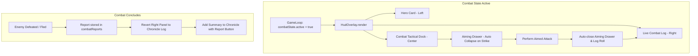

# Combat View & Live Combat Log Overhaul Implementation Plan

> **For agentic workers:** REQUIRED SUB-SKILL: Use superpowers:subagent-driven-development to implement this plan task-by-task. Steps use checkbox (`- [ ]`) syntax for tracking.

**Goal:** Overhaul the turn-based combat interface so it remains docked to the bottom of the screen (preventing obstruction of combatants on the isometric battlefield), replaces the Chronicle with a dedicated, richly formatted Live Combat Log during battle, and introduces a one-turn auto-collapsing drawer for Advanced Anatomical Targeting.

**Architecture:**
1. In `src/ui/hudOverlay.ts`, update `bottom-hud` during active combat to adopt a 3-column tactical dock: Left (Hero Card), Center (Tactical Action Deck), Right (Live Combat Log).
2. Reposition `.combat-tactical-bar` from floating at `bottom: 138px` to being cleanly docked into the bottom HUD flow.
3. Transform Advanced Anatomical Targeting into a sleek drawer (`.combat-veteran-drawer`) positioned directly over the tactical dock that automatically collapses after executing an action or round.
4. Render a dedicated `buildCombatLiveLogHtml()` during combat in place of the Chronicle, highlighting critical hits, regular damage, armor mitigation (DT/DR), dodges/misses, and status effects.
5. On combat victory or retreat, automatically revert to the world chronicle with the final combat report.

**Architecture Diagram:**

**Tech Stack:** TypeScript, HTML5/CSS3 (flexbox/grid layout, CSS keyframe animations), Vitest.

**Spec:** [docs/superpowers/specs/2026-11-12-combat-view-overhaul-design.md](file:///C:/Users/jgorski/Projekty/RPG2/docs/superpowers/specs/2026-11-12-combat-view-overhaul-design.md)

## Global Constraints
- Do not obscure the player or enemy sprites in the isometric viewport during combat.
- Retain all existing keyboard shortcuts: `[1]` Szybki Cios, `[2]` Silny Cios, `[3]` Obrona, `[V]` Tryb Celowania, `[Spacja]` Koniec Tury.
- Keep `npm test` and `npm run build` passing at all stages.

---

### Task 1: Dedykowany Dziennik Walki (Live Combat Log Component)

**Files:**
- Modify: `src/ui/hudOverlay.ts`
- Modify: `src/styles/main.css`
- Test: `tests/rpg/combatLiveLog.test.ts`

- [ ] **Step 1: Write test for Live Combat Log rendering during combat**
Create `tests/rpg/combatLiveLog.test.ts` testing that when `game.combatState.active === true`, the bottom HUD renders `.combat-live-log` with formatted entries (hits, misses, crits, armor reduction) instead of `.chronicle-log`.

- [ ] **Step 2: Run test to verify it fails**
Run: `npx vitest run tests/rpg/combatLiveLog.test.ts`
Expected: FAIL

- [ ] **Step 3: Implement `buildCombatLiveLogHtml()` in `src/ui/hudOverlay.ts` and styling in `src/styles/main.css`**
Add method `buildCombatLiveLogHtml()` parsing `this.game.combatLogs` into rich semantic entries with badges (`KRYTYK`, `TRAFIENIE`, `PUDŁO`, `GARDA`).

- [ ] **Step 4: Run test to verify it passes**
Run: `npx vitest run tests/rpg/combatLiveLog.test.ts`
Expected: PASS

- [ ] **Step 5: Commit**
`git add src/ui/hudOverlay.ts src/styles/main.css tests/rpg/combatLiveLog.test.ts && git commit -m "feat(combat): implement dedicated live combat log in bottom hud"`

---

### Task 2: Dolny Dok Taktyczny Walki (Bottom Docked Tactical Bar)

**Files:**
- Modify: `src/ui/hudOverlay.ts`
- Modify: `src/styles/main.css`
- Test: `tests/ui/combatTacticalDock.test.ts`

- [ ] **Step 1: Write test for bottom-docked combat layout**
Verify `.bottom-hud.combat-mode-active` houses the hero card, tactical bar, and live combat log, leaving viewport clear.

- [ ] **Step 2: Run test to verify it fails**
Run: `npx vitest run tests/ui/combatTacticalDock.test.ts`
Expected: FAIL

- [ ] **Step 3: Update `src/ui/hudOverlay.ts` and `src/styles/main.css` for docked layout**
Refactor `.combat-tactical-bar` to be part of `.bottom-hud` during combat with sleek height (~140px), action buttons, AP orbs, and target status.

- [ ] **Step 4: Run test to verify it passes**
Run: `npx vitest run tests/ui/combatTacticalDock.test.ts`
Expected: PASS

- [ ] **Step 5: Commit**
`git add src/ui/hudOverlay.ts src/styles/main.css tests/ui/combatTacticalDock.test.ts && git commit -m "feat(combat): dock tactical combat bar into bottom hud"`

---

### Task 3: Wysuwka Zaawansowanego Celowania Anatomicznego z Auto-Zwijaniem (1-Turn Aiming Drawer)

**Files:**
- Modify: `src/ui/hudOverlay.ts`
- Modify: `src/styles/main.css`
- Test: `tests/rpg/combatSystem.test.ts` or `tests/ui/combatTacticalDock.test.ts`

- [ ] **Step 1: Write test for 1-turn auto-collapsing aiming drawer**
Verify that executing an aimed attack resets `isCombatAdvancedOpen = false` and renders the collapsed deck.

- [ ] **Step 2: Run test to verify it fails**
Run: `npx vitest run tests/ui/combatTacticalDock.test.ts`
Expected: FAIL

- [ ] **Step 3: Implement drawer layout and auto-collapse behavior**
Position `.combat-veteran-drawer` above tactical deck and add auto-close logic on click / shortcut execution.

- [ ] **Step 4: Run test to verify it passes**
Run: `npx vitest run tests/ui/combatTacticalDock.test.ts`
Expected: PASS

- [ ] **Step 5: Commit**
`git add src/ui/hudOverlay.ts src/styles/main.css tests/ui/combatTacticalDock.test.ts && git commit -m "feat(combat): implement auto-collapsing anatomical targeting drawer"`

---

### Task 4: Pełna Weryfikacja Integracyjna i Budowanie Projektu

**Files:**
- All touched files
- Run: `npm test` and `npm run build`
